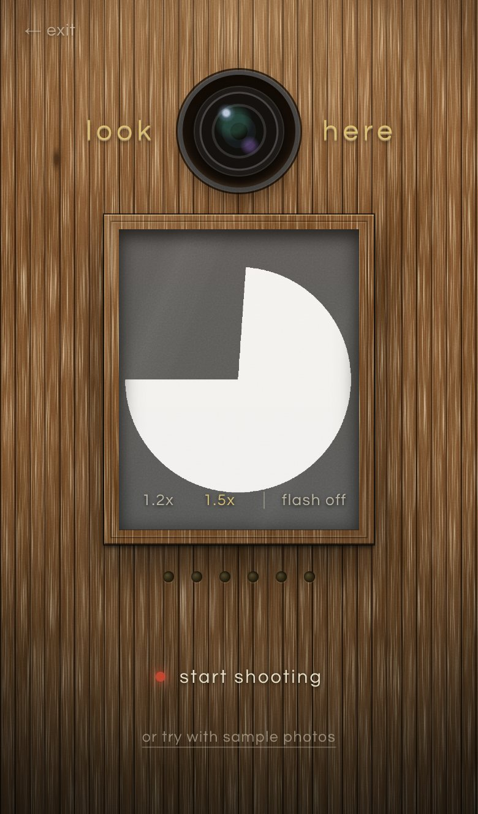
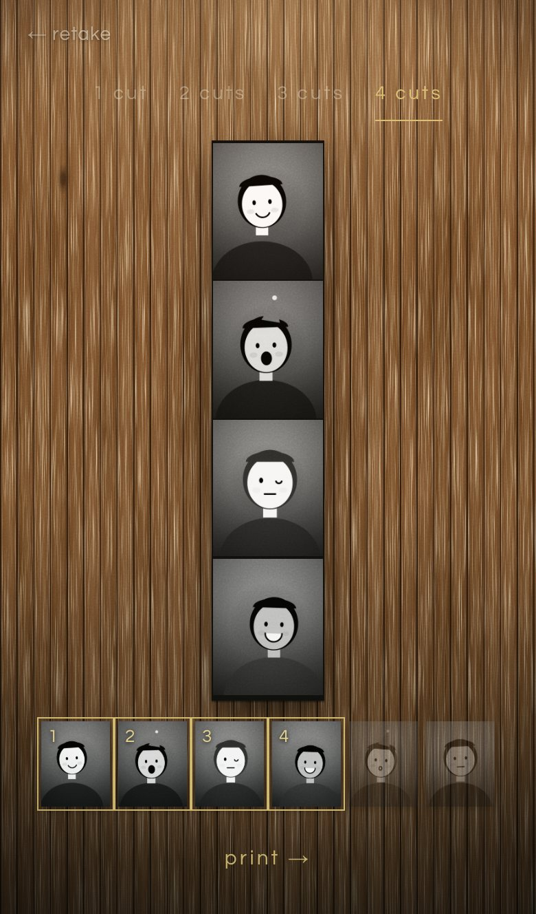

# photobooth

연말 흑백 빈티지 포토부스 웹. 커튼을 열고 들어가 6장을 찍고, 마음에 드는 컷을 골라 검정 프레임 사진으로 인화한 뒤, 사진 배경 위에 올려 **인스타 피드(3:4) · 스토리(9:16)** 이미지로 저장합니다.

**서버가 없습니다.** 사진은 기기 밖으로 나가지 않고, 각자 브라우저(IndexedDB)에만 저장됩니다.

- Next.js 16 (App Router) · React 19 · TypeScript
- 카메라: `getUserMedia` (HTTPS 필수) · 합성: Canvas

## 빠른 시작

Node.js 20 이상이 필요합니다.

```bash
git clone https://github.com/lovejoohero0228/photobooth.git
cd photobooth
npm install
npm run dev -- -p 3123
```

브라우저에서 <http://localhost:3123> 을 엽니다. `localhost`는 HTTPS가 아니어도 카메라가 켜집니다.

> 휴대폰에서 열어 보려면 아래 [휴대폰에서 테스트](#휴대폰에서-테스트)를 보세요.

## 사용법

화면은 `/` 하나이고, 페이지 이동 없이 이어집니다. 아래 스크린샷의 카메라 화면은 개발용 가짜 영상(테스트 패턴)입니다.

### 1. 부스 밖 — `enter`

커튼의 `enter` 쪽지를 누르면 커튼이 걷히고 문 안으로 들어갑니다. 사진을 찍은 뒤에는 왼쪽 배출구에 최근 사진이 꽂혀 보이고, 누르면 보관함(my photos)이 열립니다.


### 2. 부스 안 — 카메라

들어가면 바로 카메라가 켜집니다.

- 화면 아래 `1.2x` / `1.5x`로 확대 배율을 고릅니다. 휴대폰 전면 카메라는 광각이라 확대 옵션을 뒀고, 고른 배율은 기기에 기억됩니다.
- `start shooting`을 누르면 5초를 세고 한 장씩, 총 6장을 연속으로 찍습니다. 기다리기 싫으면 `shoot now`로 바로 찍을 수 있습니다.
- 카메라를 쓸 수 없으면 `upload photos`로 사진을 불러오거나, `or try with sample photos`로 샘플 컷 6장을 만들어 바로 뒷 단계로 갈 수 있습니다.

 

### 3. 레이아웃과 컷 고르기

위에서 `1 cut · 2 cuts · 3 cuts · 4 cuts` 중 레이아웃을 고르고, 아래 6장 중 넣을 컷을 순서대로 누릅니다. 위쪽 미리보기에 바로 반영됩니다. 다 채우면 `print →`가 켜집니다. `← retake`로 처음부터 다시 찍을 수 있습니다.



### 4. 인화와 저장

잠깐 인화되는 모션 뒤에 사진이 배출구에서 내려와 화면 가운데 틀로 똑 떨어집니다.

 

아래에서 배경과 옵션을 고르고 `save`를 누릅니다. 위의 틀은 **저장될 이미지 그대로**입니다.

| 옵션 | 설명 |
|---|---|
| 배경 칩 | `plain`(사진만) 또는 `public/bg/`의 사진 배경. 옆으로 밀면 더 있습니다 |
| `frame` | 켜면 검정 프레임, 끄면 프레임 자리가 투명한 공백(기본: 끔) |
| `tilt` | 배경 위에서 사진을 살짝 기울임(기본: 켬) |
| `3:4` / `9:16` | 저장 이미지 비율. 인스타 피드용 / 스토리용 |
| `← layout` | 레이아웃·컷 고르기 화면으로 돌아감(찍은 컷은 그대로) |
| `shoot again →` | 처음부터 다시 촬영 |

 

`save` 동작은 기기에 따라 다릅니다.

- **아이폰:** 공유 시트가 열립니다. 거기서 "이미지 저장"을 고르세요.
- **안드로이드 · PC:** 파일이 바로 다운로드됩니다.
- **인스타그램·카카오톡 같은 인앱 브라우저:** 카메라나 저장이 막힐 수 있어 상단에 안내가 뜹니다. 외부 브라우저로 여세요.

## 휴대폰에서 테스트

카메라는 **HTTPS**에서만 동작하므로, 같은 와이파이의 휴대폰에서 보려면 자체 서명 인증서로 띄웁니다.

```bash
mkdir -p certificates
openssl req -x509 -newkey rsa:2048 -nodes -days 30 \
  -keyout certificates/lan-key.pem -out certificates/lan-cert.pem \
  -subj "/CN=photobooth-lan" \
  -addext "subjectAltName=IP:<내 PC IP>,DNS:localhost,IP:127.0.0.1"
npm run dev:lan
```

휴대폰 브라우저에서 `https://<내 PC IP>:3123` 을 열고, 인증서 경고는 "고급 → 계속 진행"으로 넘깁니다. `certificates/`는 git에 올라가지 않습니다.

> 자체 서명 인증서에서는 안드로이드 크롬이 다운로드를 막을 수 있습니다. 저장까지 확인하려면 아래처럼 정식 HTTPS 주소로 배포해서 테스트하세요.

임시 HTTPS 터널을 쓸 수도 있습니다.

```bash
cloudflared tunnel --url http://localhost:3123
```

켜져 있는 동안은 주소를 아는 누구나 접속할 수 있으니 테스트 후 바로 끄세요.

## 배포

정적으로 빌드되는 앱이라 어디든 올릴 수 있습니다. [Vercel](https://vercel.com)이 가장 간단합니다.

1. Vercel에서 이 GitHub 레포를 Import → Deploy
2. 생성된 `https://….vercel.app` 주소를 폰에서 열기 (정식 HTTPS라 카메라·저장이 바로 동작)

로컬에서 프로덕션 빌드를 확인하려면 `npm run build && npm start`.

## 바꿔 보기

| 바꾸고 싶은 것 | 파일 |
|---|---|
| 촬영 장수 · 카운트다운 · 인화 대기 시간 · 카메라 배율 | `src/lib/config.ts` |
| 사진 톤(노출·대비) | `src/lib/tone.ts` (`DEFAULT_TONE`) |
| 레이아웃(컷 수)과 배경 위 사진 크기 | `src/lib/frames.ts` |
| 프레임 두께 | `src/lib/frames.ts`의 `PAD` · `GAP` · `FOOT` |
| 배경 사진 추가·삭제 | `public/bg/`에 파일을 넣고 `src/lib/develop.ts`의 `BACKDROPS`에 한 줄 |
| 나무 질감·색 (모든 화면 공통) | `src/app/globals.css`의 `--wood-boards` |

`/tone` 페이지에서 노출·대비·색감과 뷰티 효과(피부 매끈하게, 빛번짐, 그늘 밝히기)를 슬라이더로 직접 만져 볼 수 있습니다. 사진을 찍거나 불러오면 원본과 결과가 나란히 보이고, `use on this device`를 누르면 그 기기의 부스가 그 값을 씁니다. 마음에 드는 값은 `copy values`로 복사해 `DEFAULT_TONE`에 옮겨 적으면 모두에게 적용됩니다.

## 구조

| 경로 | 내용 |
|---|---|
| `src/components/pb/Booth.tsx` | 장면 전환(밖·안·배출구)을 맡는 최상위 |
| `src/components/pb/Exterior.tsx` | 부스 외관 일러스트 (CSS) |
| `src/components/pb/Interior.tsx` | 부스 안: 촬영, 레이아웃·컷 고르기 |
| `src/components/pb/Delivery.tsx` | 인화, 배경·옵션 선택, 저장 |
| `src/components/pb/Album.tsx` | 기기 안 보관함 |
| `src/components/camera/useCamera.ts` | 카메라 스트림·확대 배율 |
| `src/lib/frames.ts` | 레이아웃(인화지 모양) 정의 |
| `src/lib/develop.ts` | 흑백 현상, 인화지·배경 합성, 저장·공유 |
| `src/lib/tone.ts` | 사진 톤 설정과 비교용 후보 |
| `src/lib/strips.ts` | 기기 안 저장소 (IndexedDB) |
| `public/bg/` | 배경 사진 |
| `archive/v1/` | 이전 버전 화면. 빌드에서 제외 |
| `docs/phase2/` | 원격 참여 버전(2단계)용 스키마·인프라 설계 |
| `photobooth-spec.md` | 기획 문서 |

> 이 프로젝트의 Next.js는 학습 자료와 다른 부분이 있는 최신 버전입니다. 코드를 고치기 전에 `node_modules/next/dist/docs/`의 해당 가이드를 확인하세요 (`AGENTS.md` 참고).
