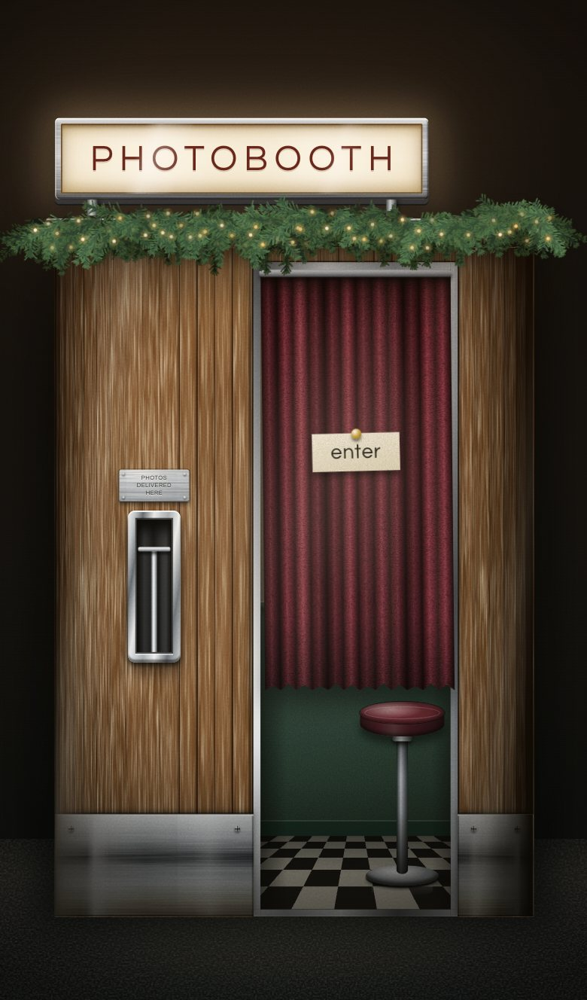
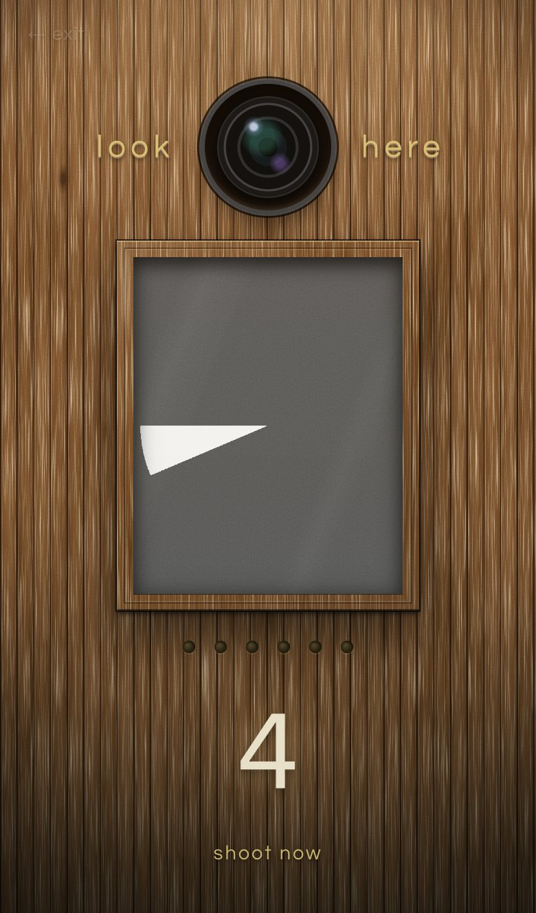
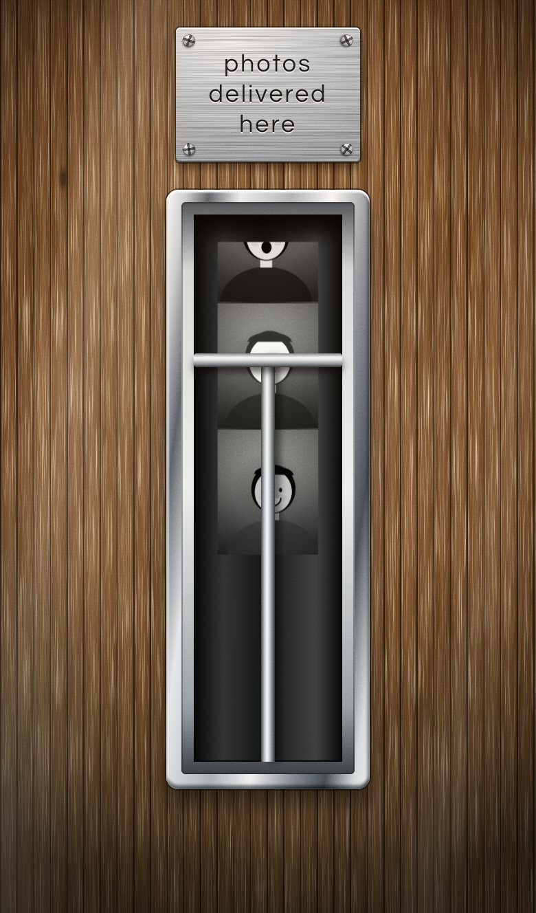
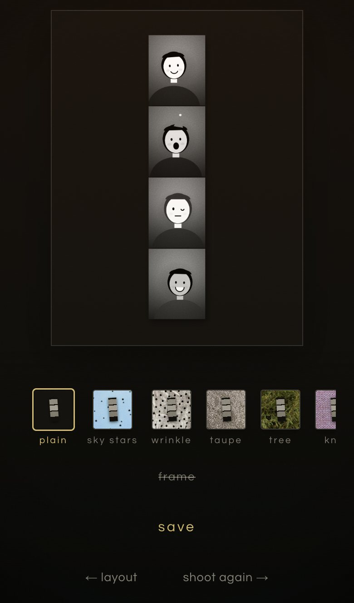
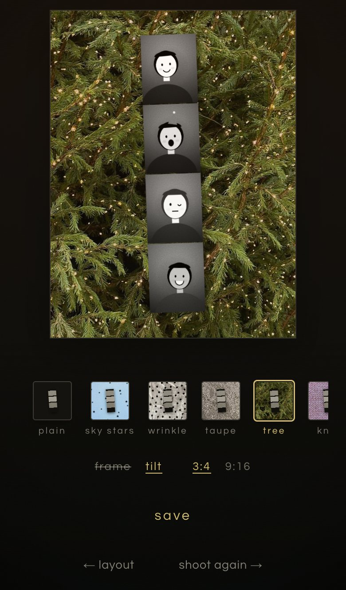
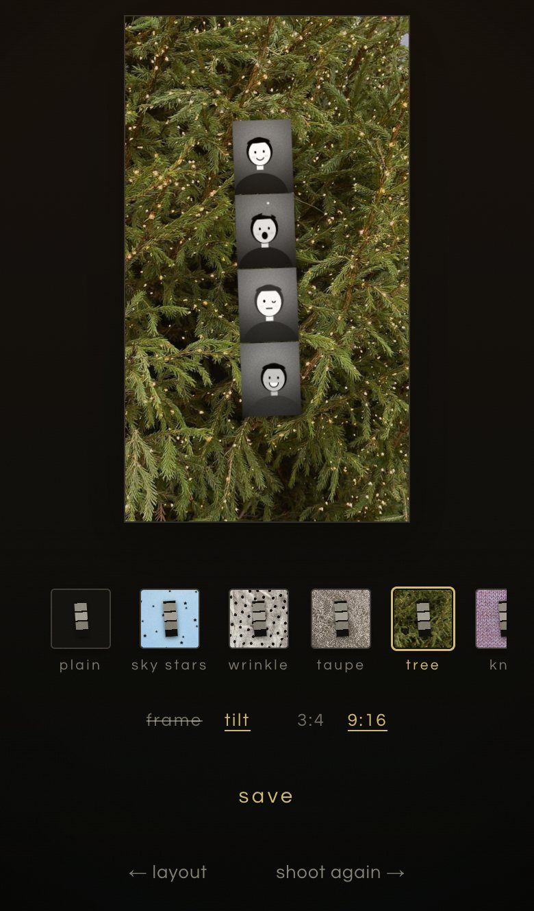
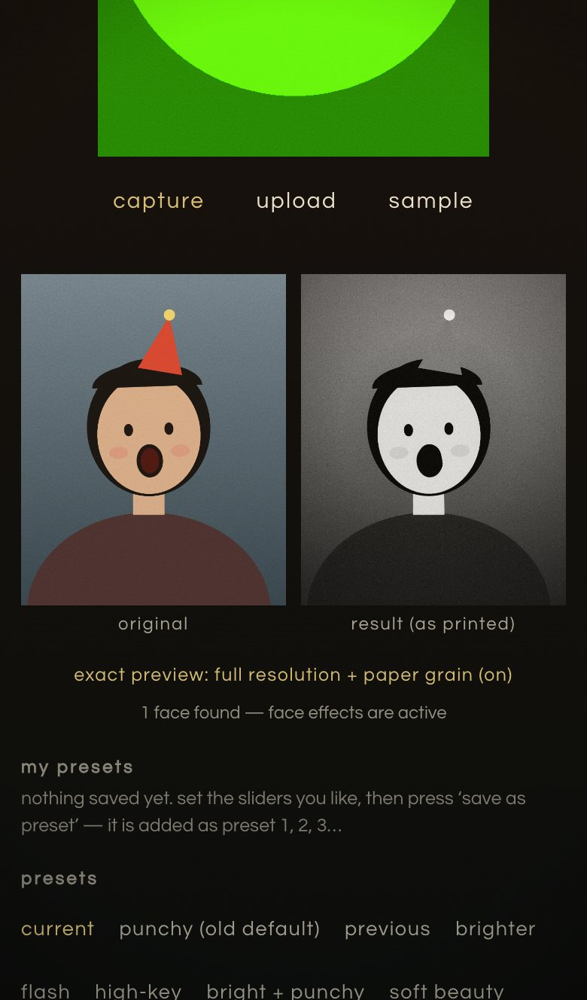

# photobooth

연말 흑백 빈티지 포토부스 웹. 커튼을 열고 들어가 6장을 찍고, 마음에 드는 컷을 골라 얇은 검정 프레임 사진으로 인화한 뒤, 사진 배경 위에 올려 **인스타 피드(3:4) · 스토리(9:16)** 이미지로 저장합니다. 은은한 얼굴·피부 보정과 톤 조정이 들어 있습니다.

**서버가 없습니다.** 사진은 기기 밖으로 나가지 않고, 각자 브라우저(IndexedDB)에만 저장됩니다. 얼굴 인식 모델도 기기 안에서 실행됩니다.

- Next.js 16 (App Router) · React 19 · TypeScript
- 카메라: `getUserMedia`(HTTPS 필수) · 합성과 보정: Canvas · 얼굴 인식: MediaPipe Face Landmarker(wasm)

## 빠른 시작

Node.js 20 이상이 필요합니다.

```bash
git clone https://github.com/lovejoohero0228/photobooth.git
cd photobooth
npm install        # 얼굴 인식용 wasm이 public/mediapipe/wasm 으로 자동 복사됩니다(postinstall)
npm run dev -- -p 3123
```

브라우저에서 <http://localhost:3123> 을 엽니다. `localhost`는 HTTPS가 아니어도 카메라가 켜집니다. 휴대폰에서 열어 보려면 [휴대폰에서 테스트](#휴대폰에서-테스트)를 보세요.

## 사용법

화면은 `/` 하나이고, 페이지 이동 없이 이어집니다. 아래 스크린샷의 카메라 화면은 개발용 가짜 영상(테스트 패턴)이고, 사진은 `or try with sample photos`로 만든 샘플 컷입니다.

### 1. 부스 밖 — `enter`

커튼의 `enter` 쪽지를 누르면 커튼이 걷히고 문 안으로 들어갑니다. 상단 간판은 네온처럼 깜빡이고, 가랜드의 작은 전구도 반짝입니다. 사진을 찍은 뒤에는 왼쪽 배출구에 최근 사진이 꽂혀 보이고, 누르면 보관함(my photos)이 열립니다.



### 2. 부스 안 — 카메라

들어가면 바로 카메라가 켜집니다.

- 화면 아래에서 확대 배율 `1.2x` / `1.5x`를 고르고, `flash on/off`로 플래시를 켜고 끕니다. 두 설정은 기기에 기억됩니다.
  - 휴대폰 전면 카메라는 광각이라 확대 옵션을 뒀습니다(아이폰 기본 1.5x, 그 밖의 기기 1.2x).
  - 플래시: 카메라가 토치를 지원하면 그것을, 아니면(전면 카메라 대부분) 마지막 1초에 화면 전체를 환하게 켭니다.
- `start shooting`을 누르면 5초를 세고 한 장씩, 총 6장을 연속으로 찍습니다. 기다리기 싫으면 숫자 아래 `shoot now`로 바로 찍습니다.
- 카메라를 쓸 수 없거나 빠르게 둘러보고 싶으면 `upload photos` 또는 `or try with sample photos`(샘플 컷 6장)로 바로 다음 단계로 갑니다.

 

### 3. 레이아웃과 컷 고르기

위에서 `1 cut · 2 cuts · 3 cuts · 4 cuts` 중 레이아웃을 고르고, 아래 6장 중 넣을 컷을 순서대로 누릅니다. 위쪽 미리보기에 바로 반영됩니다. 다 채우면 `print →`가 켜집니다. `← retake`로 처음부터 다시 찍을 수 있습니다. 여기 보이는 컷은 이미 톤과 보정(아래 [사진 보정](#사진-보정))이 적용된 결과입니다.


### 4. 인화와 저장

잠깐 인화되는 모션 뒤에 사진이 배출구에서 내려와 화면의 틀로 똑 떨어집니다.

 

아래에서 배경과 옵션을 고르고 `save`를 누릅니다. 위의 틀은 **저장될 이미지 그대로**입니다.

| 옵션 | 설명 |
|---|---|
| 배경 칩 | `plain`(사진만) 또는 `public/bg/`의 사진 배경 15개. 옆으로 밀면 더 있습니다 |
| `frame` | 켜면 검정 프레임, 끄면 프레임 자리가 투명한 공백(기본: 끔) |
| `tilt` | 배경 위에서 사진을 살짝 기울임(기본: 켬) |
| `3:4` / `9:16` | 저장 이미지 비율. 인스타 피드용 / 스토리용 |
| `← layout` | 레이아웃·컷 고르기 화면으로 돌아감(찍은 컷은 그대로) |
| `shoot again →` | 처음부터 다시 촬영 |

레이아웃마다 배경 위에서 사진이 차지하는 크기가 다릅니다. 컷이 적을수록 사진이 작고 배경 여백이 넓습니다(1컷은 3×3 격자의 가운데 칸 크기). 9:16은 3:4보다 사진이 조금 작게 놓입니다.

 

`save` 동작은 기기에 따라 다릅니다.

- **아이폰:** 공유 시트가 열립니다. 거기서 "이미지 저장"을 고르세요.
- **안드로이드 · PC:** 파일이 바로 다운로드됩니다.
- **인스타그램·카카오톡 같은 인앱 브라우저:** 카메라나 저장이 막힐 수 있어 상단에 안내가 뜹니다. 외부 브라우저로 여세요.

## 사진 보정

촬영하는 순간 컷마다 **흑백 톤 → 얼굴 보정 → 입자·비네팅** 순으로 현상됩니다. 기본값은 `src/lib/tone.ts`의 `DEFAULT_TONE`입니다.

- **톤:** 노출 · 중간톤 · 대비 · 밝기 · 비네팅 · 입자 · 채도(0이면 흑백) · 색조
- **뷰티:** 피부 매끈하게, 빛번짐, 그늘 밝히기
- **얼굴 모양(랜드마크로 비틂):** 갸름하게, 눈 크게, 코 폭, 턱, 얼굴 길이, 이마, 입꼬리, 입술, 눈 사이, 눈썹
- **피부·눈(부분 보정):** 눈 밑 밝히기, 눈·치아 밝히기, 번들거림, 윤곽, 잡티

얼굴 효과가 하나라도 켜져 있으면 모델(`public/mediapipe/face_landmarker.task`, 약 3.7MB)과 wasm(약 15MB)을 처음 한 번 내려받고, 모두 0이면 모델을 아예 불러오지 않습니다. 얼굴을 못 찾으면 보정 없이 그대로 둡니다.

### `/tone` — 보정 실험 페이지

슬라이더로 값을 직접 만져 보는 페이지입니다. `capture`·`upload`·`sample`로 사진을 불러오면 원본과 결과가 나란히 보입니다.



- `exact preview`(기본 켬): 부스와 같은 원본 해상도 + 인화지 결로 보여 줍니다. 끄면 빠르지만 부스와 조금 다릅니다.
- `save as preset`: 현재 값을 `preset 1, 2, 3…`으로 자동 번호를 붙여 저장합니다(이 기기). 목록에서 눌러 불러오고 `✕`로 지웁니다.
- `use on this device`: 이 기기의 부스가 그 값을 씁니다. `reset`은 기본값으로 되돌립니다.
- `copy values`: 값을 JSON으로 복사합니다. 모두에게 적용하려면 `DEFAULT_TONE`에 붙여 넣으세요.

## 휴대폰에서 테스트

카메라는 **HTTPS**에서만 동작하므로, 같은 와이파이의 휴대폰에서 보려면 자체 서명 인증서로 띄웁니다.

```bash
mkdir -p certificates
openssl req -x509 -newkey rsa:2048 -nodes -days 30 \
  -keyout certificates/lan-key.pem -out certificates/lan-cert.pem \
  -subj "/CN=photobooth-lan" \
  -addext "subjectAltName=IP:<내 PC IP>,DNS:localhost,IP:127.0.0.1"
npm run dev:lan
```

휴대폰 브라우저에서 `https://<내 PC IP>:3123` 을 열고, 인증서 경고는 "고급 → 계속 진행"으로 넘깁니다. `certificates/`는 git에 올라가지 않습니다.

> 자체 서명 인증서에서는 안드로이드 크롬이 다운로드를 막을 수 있습니다. 저장까지 확인하려면 아래처럼 정식 HTTPS 주소로 배포해서 테스트하세요.

임시 HTTPS 터널을 쓸 수도 있습니다.

```bash
cloudflared tunnel --url http://localhost:3123
```

켜져 있는 동안은 주소를 아는 누구나 접속할 수 있으니 테스트 후 바로 끄세요.

## 배포

서버 기능이 필요 없어서 어디든 올릴 수 있습니다. [Vercel](https://vercel.com)이 가장 간단합니다.

1. Vercel에서 이 GitHub 레포를 Import → Deploy (설치 단계에서 얼굴 인식용 wasm이 자동으로 복사됩니다)
2. 생성된 `https://….vercel.app` 주소를 폰에서 열기 (정식 HTTPS라 카메라·저장이 바로 동작)

로컬에서 프로덕션 빌드를 확인하려면 `npm run build && npm start`.

## 바꿔 보기

| 바꾸고 싶은 것 | 파일 |
|---|---|
| 촬영 장수 · 카운트다운 · 인화 대기 · 카메라 배율 | `src/lib/config.ts` |
| 사진 톤·색감·뷰티·얼굴 보정 기본값 | `src/lib/tone.ts` (`DEFAULT_TONE`) |
| 레이아웃(컷 수)과 배경 위 사진 크기 | `src/lib/frames.ts` (`story`) |
| 프레임 두께 | `src/lib/frames.ts`의 `PAD` · `GAP` · `FOOT` |
| 배경 사진 추가·삭제·순서 | `public/bg/`에 파일을 넣고 `src/lib/develop.ts`의 `BACKDROPS` 수정 |
| 나무 질감·색 (모든 화면 공통) | `src/app/globals.css`의 `--wood-boards` |
| 부스 외관(가랜드 · 곡면 · 바닥 · 간판) | `src/components/pb/Exterior.*` · `Garland.tsx` · `BoothSides.tsx` · `Floor.tsx` |

## 폰트 · 라이선스

| 폰트 | 용도 | 라이선스 |
|---|---|---|
| [Questrial](https://fonts.google.com/specimen/Questrial) | 영문 전체 (간판 · 버튼 · 안내) | SIL Open Font License 1.1 — Copyright 2011 The Questrial Project Authors |

Questrial은 Next.js의 `next/font/google`로 빌드 때 받아 우리 서버에서 함께 내보냅니다. Regular(400) 한 가지 굵기뿐이라 화면의 모든 굵기를 400으로 맞췄습니다. SIL OFL 1.1은 상업적 사용·웹 임베딩·재배포를 허용하지만, 폰트 파일 자체를 단독으로 판매하는 것과 폰트를 고쳐서 같은 이름으로 배포하는 것은 금지합니다.

얼굴 인식은 [MediaPipe Face Landmarker](https://ai.google.dev/edge/mediapipe/solutions/vision/face_landmarker)(Apache License 2.0)를 사용합니다.

## 구조

| 경로 | 내용 |
|---|---|
| `src/components/pb/Booth.tsx` | 장면 전환(밖·안·배출구)을 맡는 최상위 |
| `src/components/pb/Exterior.tsx` | 부스 외관 일러스트(CSS + SVG) |
| `src/components/pb/Garland.tsx` · `BoothSides.tsx` · `Floor.tsx` | 가랜드와 전구, 둥근 옆면 곡면, 체커보드 바닥 |
| `src/components/pb/Interior.tsx` | 부스 안: 촬영(카운트다운·플래시·배율), 레이아웃·컷 고르기 |
| `src/components/pb/Delivery.tsx` | 인화, 배경·옵션 선택, 저장 |
| `src/components/pb/Album.tsx` | 기기 안 보관함 |
| `src/components/camera/useCamera.ts` | 카메라 스트림 · 확대 배율 · 토치 |
| `src/app/tone/page.tsx` | `/tone` 보정 실험 페이지 |
| `src/lib/frames.ts` | 레이아웃(인화지 모양)과 배경 위 크기 정의 |
| `src/lib/develop.ts` | 컷 현상, 인화지·배경 합성, 저장·공유 |
| `src/lib/tone.ts` | 보정 값 정의 · 기본값 · 프리셋 저장 |
| `src/lib/beauty.ts` | 피부 매끈하게 · 빛번짐 · 그늘 밝히기 |
| `src/lib/face.ts` | 얼굴 인식, 얼굴 모양 비틀기, 피부·눈 부분 보정 |
| `src/lib/samples.ts` | 샘플 컷(그린 얼굴) |
| `src/lib/strips.ts` | 기기 안 저장소 (IndexedDB) |
| `scripts/copy-mediapipe.mjs` | 설치 후 wasm을 `public/mediapipe/wasm`으로 복사 |
| `public/bg/` · `public/mediapipe/` | 배경 사진 · 얼굴 인식 모델 |
| `archive/v1/` | 이전 버전 화면. 빌드에서 제외 |
| `docs/phase2/` | 원격 참여 버전(2단계)용 스키마·인프라 설계 |
| `photobooth-spec.md` | 기획 문서 |

> 이 프로젝트의 Next.js는 학습 자료와 다른 부분이 있는 최신 버전입니다. 코드를 고치기 전에 `node_modules/next/dist/docs/`의 해당 가이드를 확인하세요 (`AGENTS.md` 참고).
